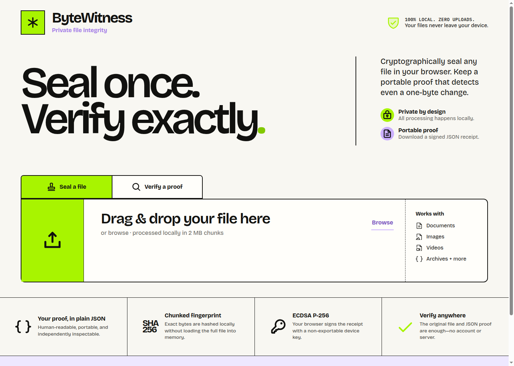

# ByteWitness

ByteWitness creates portable, self-signed file integrity receipts entirely in the browser. A file is hashed in chunks with SHA-256, the receipt is signed with a non-exportable ECDSA P-256 device key, and the resulting JSON proof can be verified later with no account, upload, or server.

[Try ByteWitness](https://bytewitness.regal-flame-7335.chatgpt.site) · [Devpost project](https://devpost.com/software/bytewitness)



## Why it exists

Students, creators, journalists, and freelancers often need a simple way to show that a file they shared later is byte-for-byte identical to the one they sealed. Existing timestamp and blockchain products can add stronger third-party time guarantees, but they also add infrastructure, cost, and trust dependencies. ByteWitness is the small, private baseline: deterministic integrity and receipt-authenticity verification that works offline after the app loads.

## Judge demo

1. Open ByteWitness and seal a small file.
2. Download the `.bytewitness.json` proof.
3. Verify the original file with that proof: the result is an exact match with a valid ECDSA signature.
4. Change one character in the original file and verify again: ByteWitness reports a file mismatch.
5. Edit any signed field in the JSON receipt and verify again: ByteWitness rejects the signature.

The whole flow is visible in the browser network panel: no file or hash is sent anywhere.

## Security model

ByteWitness proves:

- the checked file has the same SHA-256 fingerprint recorded in the receipt;
- the receipt fields have not changed since they were signed;
- the receipt was signed by the private key corresponding to its included public key;
- receipts created in the same browser profile normally share the same device key ID.

ByteWitness does **not** independently prove a person's identity, legal ownership, or a trusted external creation time. The displayed time comes from the user's device clock. A malicious person can create their own key and receipt. For authorship claims, publish or exchange the displayed key ID through an independently trusted channel.

The private signing key is generated by Web Crypto as non-exportable and stored in IndexedDB when the browser allows it. Clearing site data removes the signing key, but existing receipts remain verifiable because they include the public key. Hardened or private-browsing environments may fall back to a session-only key and show that state explicitly.

## Local development

Requirements: Node.js 22+ and npm 10+.

```bash
npm install
npm run dev
```

Run the complete local release gate:

```bash
npm run check
```

## Architecture

- React 19 + Vite 6 static web application
- TypeScript with strict checking
- Web Crypto ECDSA P-256 signatures
- Incremental SHA-256 hashing with `@noble/hashes` in 2 MB chunks
- Zod validation for untrusted proof receipts
- IndexedDB for the non-exportable browser signing key
- No backend, analytics, accounts, cookies, or network API

## Proof format

Proofs are readable JSON and use format `bytewitness-proof`, version `1`. The signature covers the format version, client-clock time, exact file metadata and SHA-256 fingerprint, signing algorithm, key ID, and public key. Verification rejects unknown fields and unsupported versions.

## Privacy

ByteWitness processes original files entirely on the device. The deployed static app does not receive the file, fingerprint, receipt, or key. Font files and icons are bundled with the application rather than loaded from third parties.

## Open-source attribution

- [React](https://react.dev/) — MIT
- [Vite](https://vite.dev/) — MIT
- [Noble Hashes](https://github.com/paulmillr/noble-hashes) — MIT
- [Zod](https://zod.dev/) — MIT
- [Phosphor Icons](https://phosphoricons.com/) — MIT
- [Bricolage Grotesque](https://github.com/ateliertriay/bricolage) and [IBM Plex Mono](https://github.com/IBM/plex) — SIL Open Font License 1.1

## License

MIT
